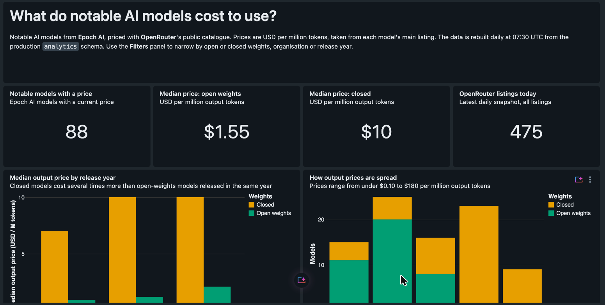
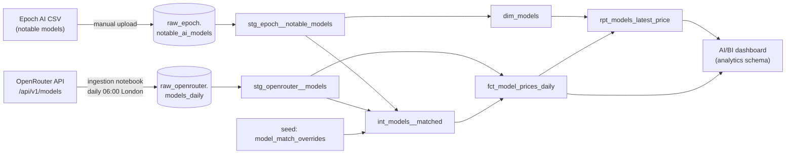

# AI Model Tracker

A dbt project on Databricks that answers **which AI model is best at what**. Benchmark history starts from a one-time baseline from [Epoch AI](https://epoch.ai/benchmarks); every model released since is added from **its own release page**, stored in Databricks and built through dbt. It also tracks **what notable AI models are** (Epoch) and **what they cost to use** ([OpenRouter](https://openrouter.ai/), with daily price history).

Built as an Analytics Engineering portfolio project: layered dbt models, tested grain, source freshness, documented conventions, and every change reviewed through a pull request.

---

## What it answers

- Which model is best at coding, writing, maths, science, reasoning and agentic work, on which benchmark, and how has each company's best score moved over time?
- Which notable AI models can I actually buy access to today, and at what price per million tokens?
- How do open-weights models compare on price with closed models?
- How do prices change from day to day, and when does a listing disappear?
- Which organisations, release years and domains do the priced models come from?

### Website

**[nicholas-create.github.io/dbt-databricks-sandbox](https://nicholas-create.github.io/dbt-databricks-sandbox/)**: a benchmark leaderboard by category (with an "Overall" score per category) and a race of each company's best score over time. Scores reported by a model's own developer are marked with an asterisk. It's a static page (`site/`): after each successful production build, `scripts/export_site_data.py` reads the benchmark marts from the `analytics` schema into one JSON file and `.github/workflows/site.yml` publishes it to GitHub Pages. The browser never connects to Databricks.

### Dashboard (internal)

A Databricks AI/BI dashboard on the production marts, rebuilt daily. Only workspace users can open it, which is why the public view is the website above. Details and deployment steps are in [`dashboards/README.md`](dashboards/README.md).



**Example result** (snapshot of 13 Nov 2026, models released in 2025 or later with a current standard OpenRouter price):

| | Priced models | Median output price (USD / M tokens) |
|---|---|---|
| Open weights | 39 | 1.90 |
| Closed | 44 | 10.00 |

```sql
select is_open_weights, count(*), percentile_approx(output_price_usd_per_mtok, 0.5)
from rpt_models_latest_price
where has_price and release_year >= 2025
group by 1
```

---

## Architecture



Benchmarks:

```mermaid
flowchart LR
    epoch_zip["Epoch AI benchmark hub<br/>(benchmark_data.zip)"] -->|"one-off load<br/>14 Nov 2026 (baseline)"| raw_bench[("raw_epoch.<br/>benchmark_rows")]
    release["Model release pages<br/>(one batch per release)"] -->|"INSERT, append-only<br/>ingestion/manual/releases/"| raw_manual[("raw_manual.<br/>benchmarks +<br/>benchmark_scores")]

    raw_bench --> stg_rows["stg_epoch__benchmark_rows<br/>stg_epoch__eci_*"]
    raw_manual --> stg_manual["stg_manual__benchmarks<br/>stg_manual__benchmark_scores"]

    catalog["seeds: benchmark_catalog,<br/>benchmark_categories"] --> int_bench["int_benchmarks__unioned"]
    stg_manual --> int_bench
    stg_rows --> int_epoch["int_benchmark_scores__epoch"]
    int_bench --> int_epoch
    int_epoch --> int_union["int_benchmark_scores__unioned<br/>(manual supersedes Epoch)"]
    stg_manual --> int_union

    int_union --> fct_bench["fct_benchmark_scores"]
    rpt_price["rpt_models_latest_price"] --> fct_bench
    fct_bench --> dim_bench["dim_benchmarks"]
    fct_bench --> overall["fct_benchmark_category_scores<br/>(Python: IRT fit)"]
    dim_bench --> overall

    fct_bench -->|export_site_data.py| site["Website<br/>(GitHub Pages)"]
    dim_bench --> site
    overall --> site
```



**Stack:** Databricks Free Edition (Delta tables, SQL warehouse, scheduled job) · dbt Core 1.12 / dbt Studio · GitHub.

| Layer | Built as | Purpose |
|---|---|---|
| Raw (`workspace.raw_*`) | Delta tables, loaded outside dbt | Source data exactly as published. OpenRouter is stored as untouched JSON plus `loaded_at`, appended daily |
| Staging | Views | Rename, cast, parse JSON, deduplicate same-day reloads. No joins, no business filters |
| Intermediate | Views | Name matching between the two sources |
| Marts | Tables | Dimension, fact and report tables ready for a dashboard |

### Models

| Model | Grain | Notes |
|---|---|---|
| `stg_epoch__notable_models` | One row per Epoch model | 1,091 models, 1950–2026 |
| `stg_openrouter__models` | One row per OpenRouter model per snapshot date | Prices converted from USD per token (text) to `decimal` USD per million tokens. Router placeholder prices (`-1`) become null with `is_variable_priced` |
| `int_models__matched` | One row per OpenRouter model | Links each listing to an Epoch model: manual override first, then an automatic match on a normalised name key (`model_match_key` macro) |
| `dim_models` | One row per Epoch model | Organisation, release year, domains, `access_type`, `is_open_weights`, parameters, training compute |
| `fct_model_prices_daily` | One row per OpenRouter model per snapshot date | All listings kept, matched or not (5,517 rows over 12 snapshots, 1–13 Nov 2026) |
| `rpt_models_latest_price` | One row per Epoch model | Latest standard price where one exists; unpriced models kept with `has_price = false` |
| `stg_epoch__benchmark_rows` | One row per CSV row in Epoch's benchmark hub (latest load) | ~12,000 rows from ~90 files; each row's columns kept as a `map`, since the score column differs per file |
| `stg_manual__benchmark_scores` | One row per benchmark per model (latest entry) | Hand-entered results; corrections and retractions are newer rows |
| `int_benchmark_scores__epoch` | One row per benchmark per model | Each model's best run, names resolved through Epoch's own version → name map |
| `int_benchmark_scores__unioned` | One row per benchmark per model | Epoch + manual; a manual entry supersedes Epoch's score |
| `dim_benchmarks` | One row per benchmark | Category, scale, publisher, harnesses, coverage |
| `fct_benchmark_scores` | One row per benchmark per model | The score the site shows, its source (`epoch` / `manual`), model details and today's price |
| `fct_benchmark_category_scores` | One row per category per model | dbt **Python** model: item response theory fit across a category's benchmarks (on Databricks serverless) |

---

## Design decisions

| Decision | Why |
|---|---|
| **Epoch is the spine; OpenRouter is the enrichment.** Reports are `dim_models left join prices`. | The question is "what do notable models cost", so every notable model stays in the report even with no price. OpenRouter also lists hundreds of fine-tunes and routers that aren't notable models. |
| **Raw data is never edited.** API records land as full JSON and are parsed in staging. | APIs add and rename fields. Storing the whole record means nothing is lost and history can always be rebuilt. |
| **Daily snapshots append, never overwrite.** | Price history only exists if old snapshots are kept. Days without a snapshot stay as gaps; nothing is forward-filled. |
| **Placeholder codes become null, with a flag.** | OpenRouter reports `-1` for routers whose price depends on the routed model. Left in place it would drag averages down; set to `0` it would look free. Null + `is_variable_priced` keeps the meaning. |
| **Manual overrides beat automatic matches.** | Name normalisation handles most pairs. A small seed (7 rows) fixes date-coded releases like `deepseek-r1-0528` → *DeepSeek-R1 (May 2025)*, and every override carries a note explaining it. |
| **Latest-price tie-break:** main listing → cheaper output price → id. | When several listings match one model, the undated main listing is the price most people pay, so it wins over cheaper dated checkpoints and previews. The final id sort keeps the result the same on every run. |
| **Money as `decimal`, units in column names** (`_usd_per_mtok`). | `double` stores fractions inexactly, and a price column without a unit invites a millionfold mistake. |
| **Epoch is a frozen baseline; release pages are the ongoing source.** Manual scores supersede the baseline and are labelled. | Epoch gave the history in one load. Waiting for third parties to add each new model would leave the site weeks behind, so every release is entered from its own announcement, as one reviewable batch file per release. Each row records its `source_url` and whether the developer reported it about its own model (`vendor_reported`); the site marks those scores. A developer's numbers for competitors' models are not entered: their own release pages are the source for those. |
| **Manual tables are append-only too.** | A correction is a new row and the latest wins; a withdrawal is a row with `is_retracted`. Nobody runs `UPDATE`, so every past entry and its timestamp stays auditable. |
| **Versions of a benchmark are linked, not merged.** FrontierCode and FrontierCode 2.0 share a `benchmark_family` and appear as one split pill. | They are different tests, so their scores must never share a ranking, but a reader should see they're related. Each version keeps its own results; the family sits where its most relevant version ranks. |
| **Benchmarks are ordered by relevance, computed in dbt.** `relevance = models released in the last 180 days with a score × headroom left for the 5 best of them`. | A benchmark is worth a front pill when current models are tested on it *and* it still separates them. Solved benchmarks (everyone at ~100%) and abandoned ones drift right on their own at each daily build; nobody maintains the order by hand. |
| **The category "Overall" is an IRT fit, not an average.** | Averages reward models that only sat easy benchmarks. Fitting a skill per model and a difficulty per benchmark compares models fairly even when they sat different benchmarks. It's iterative maths, so it's a dbt Python model rather than SQL. |

The full rules, each with a correct and an incorrect example, are in [`CONVENTIONS.md`](CONVENTIONS.md).

---

## Data quality

- **82 data tests** run on every `dbt build`: `unique` + `not_null` on every primary key (composite keys for daily and benchmark × model grain), `relationships` from matches and facts back to their dimensions (a mistyped `benchmark_id` in a manual entry fails the build), `accepted_values` on the categories that drive logic, and singular tests that fail if a negative price reaches the fact table, a score falls outside its benchmark's scale, or a hand-entered score lacks its model's lab or release date, or a benchmark family is split across categories or has an unlabelled version.
- **Constraints at entry**: the manual tables reject unknown units, unknown source types and negative scores the moment a row is inserted.
- **Daily production build**: GitHub Actions ([`.github/workflows/dbt-prod.yml`](.github/workflows/dbt-prod.yml)) rebuilds the `analytics` schema from `main` at 07:30 UTC, after the morning OpenRouter load, then checks source freshness. If the load is late, the run fails and GitHub sends an email. Dev, CI and prod each have their own schema (see `CONVENTIONS.md` §6).
- **CI on every pull request**: GitHub Actions ([`.github/workflows/dbt-ci.yml`](.github/workflows/dbt-ci.yml)) installs the pinned dbt versions and runs `dbt build` against Databricks in a separate `dbt_ci` schema. A PR is only merged once that check is green.
- **Source freshness** on the OpenRouter feed: warn after 26 hours, error after 50.
- **Spot checks** after each change: known prices and tie-breaks are checked by hand in the SQL editor. Tests prove shape; spot checks prove meaning.

Coverage as of 13 Nov 2026: 140 of 495 OpenRouter listings match an Epoch model (133 automatic, 7 manual), and 88 Epoch models have a current standard price. Most unmatched listings are fine-tunes, routers or models Epoch doesn't class as notable.

---

## Running it

dbt runs locally against a Databricks SQL warehouse. The same project also runs in dbt Studio.

**1. Install dbt** (Python 3.12, [uv](https://docs.astral.sh/uv/)):

```bash
uv venv --python 3.12
uv pip install -r requirements.txt
```

**2. Connect to Databricks.** Create `~/.dbt/profiles.yml` *outside the repo*, with credentials read from environment variables:

```yaml
default:
  target: dev
  outputs:
    dev:
      type: databricks
      catalog: workspace
      schema: dbt_<your_name>
      host: "{{ env_var('DATABRICKS_HOST') }}"
      http_path: "{{ env_var('DATABRICKS_HTTP_PATH') }}"
      token: "{{ env_var('DATABRICKS_TOKEN') }}"
      threads: 4
```

**3. Build and test:**

```bash
.venv/bin/dbt debug                  # check the connection
.venv/bin/dbt build                  # seed, run and test everything
.venv/bin/dbt source freshness       # is the OpenRouter feed up to date?
```

The raw tables have to exist first: upload the Epoch CSV to `workspace.raw_epoch.notable_ai_models` (settings in `CONVENTIONS.md` §8), import [`ingestion/ingest_openrouter_models.py`](ingestion/ingest_openrouter_models.py) as a notebook and schedule it daily, run [`ingestion/ingest_epoch_benchmarks.py`](ingestion/ingest_epoch_benchmarks.py) once for the benchmark baseline, run [`ingestion/manual/create_manual_tables.sql`](ingestion/manual/create_manual_tables.sql) once, then replay the release batches in `ingestion/manual/releases/`. See [`ingestion/README.md`](ingestion/README.md).

---

## Repository layout

```
ingestion/              OpenRouter loader (daily job), Epoch benchmark baseline loader (one-off), manual/ (tables, templates, one SQL batch per model release)
models/
  staging/epoch/        stg_epoch__notable_models, benchmark rows, Capabilities Index + source and model YAML
  staging/openrouter/   stg_openrouter__models + source (with freshness) and model YAML
  staging/manual/       hand-entered benchmarks and scores
  intermediate/         int_models__matched, int_benchmarks__unioned, int_benchmark_scores__*
  marts/                dim_models, fct_model_prices_daily, rpt_models_latest_price,
                        dim_benchmarks, fct_benchmark_scores, fct_benchmark_category_scores (Python)
macros/                 model_match_key (shared name normalisation)
seeds/                  model_match_overrides, benchmark_catalog (how to read each Epoch benchmark), benchmark_categories
tests/                  singular tests
site/                   the public website (static HTML, CSS and D3; data/ is generated at deploy)
scripts/                export_site_data.py (production marts → site/data/benchmarks.json)
dashboards/             AI/BI dashboard definition (.lvdash.json) and deployment notes
.github/workflows/      dbt-ci.yml (every pull request), dbt-prod.yml (daily prod build), site.yml (publish the website)
CONVENTIONS.md          project rules, with reasons and examples
```

---

## Sources and licences

- **Epoch AI, "Data on AI models"** (Notable AI models dataset), [epoch.ai/data/ai-models](https://epoch.ai/data/ai-models), licensed under [CC BY 4.0](https://creativecommons.org/licenses/by/4.0/). The data here is a CSV snapshot uploaded in November 2026. Credit Epoch AI wherever this data is shown.
- **Epoch AI, "Capabilities & benchmarking"**, [epoch.ai/benchmarks](https://epoch.ai/benchmarks), CC BY 4.0: the historical baseline, loaded once on 14 Nov 2026 from `epoch.ai/data/benchmark_data.zip`. It includes results Epoch collects from each benchmark's publisher.
- **Model release pages**: every model released since the baseline, entered from the developer's own announcement (each row keeps its `source_url`), e.g. [Anthropic's Claude Fable 5.2 launch post](https://www.anthropic.com/claude-fable-and-mythos-5-2). Developer-reported scores are marked with an asterisk on the site.
- **OpenRouter** public model catalogue, [`/api/v1/models`](https://openrouter.ai/api/v1/models), no API key needed. Snapshots are taken daily from 1 Nov 2026.
- The OpenRouter payload includes an Artificial Analysis benchmark block. It is **deliberately not parsed or published**, because its terms don't allow redistribution. For the same reason, Artificial Analysis benchmarks (e.g. AA-Briefcase) are never entered by hand.

## Roadmap

- Deploy the ingestion job from this repo (Databricks Asset Bundle), so the repo becomes the source of truth instead of a copy
- Categories for benchmarks that don't fit today's six (cybersecurity, robotics, protein design)
