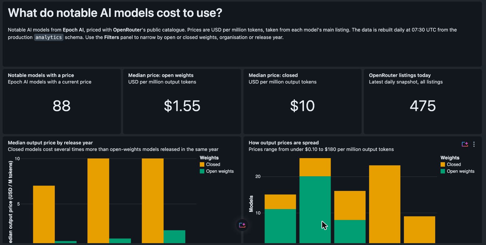
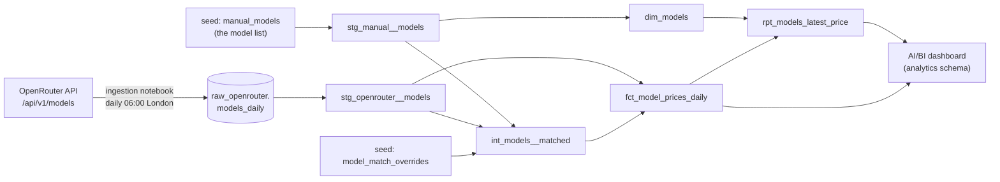
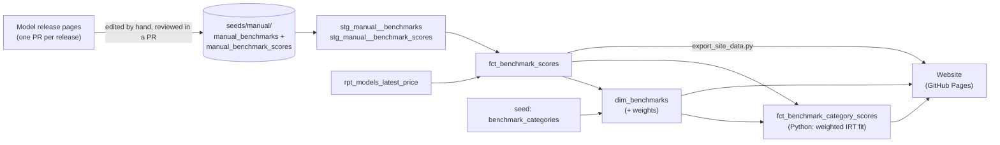

# AI Model Tracker

A dbt project on Databricks that answers **which AI model is best at what**. Every model release is added from **its own release page**: its benchmark results go into seed CSVs in this repo, dbt builds them into tested marts, and the project calculates its **own Overall score** across every benchmark. It also tracks **what each model costs to use** ([OpenRouter](https://openrouter.ai/), with daily price history).

Built as an Analytics Engineering portfolio project: layered dbt models, tested grain, source freshness, documented conventions, and every change reviewed through a pull request.

---

## What it answers

- Which model is best overall, and at coding, writing, maths, science, reasoning and agentic work, on which benchmark, and how has each company's best score moved over time?
- Which AI models can I actually buy access to today, and at what price per million tokens?
- How do open-weights models compare on price with closed models?
- How do prices change from day to day, and when does a listing disappear?
- Which organisations, release years and domains do the priced models come from?

### Website

**[nicholas-create.github.io/dbt-databricks-sandbox](https://nicholas-create.github.io/dbt-databricks-sandbox/)**: a benchmark leaderboard with a headline **Overall** tab, one tab per category (each with its own "Overall" pill), and a race of each company's best score over time. Scores reported by a model's own developer are marked with an asterisk. It's a static page (`site/`): after each successful production build, `scripts/export_site_data.py` reads the benchmark marts from the `analytics` schema into one JSON file and `.github/workflows/site.yml` publishes it to GitHub Pages. The browser never connects to Databricks.

### Dashboard (internal)

A Databricks AI/BI dashboard on the production marts, rebuilt daily. Only workspace users can open it, which is why the public view is the website above. Details and deployment steps are in [`dashboards/README.md`](dashboards/README.md).



**Example result** (snapshot of 13 Nov 2026, models released in 2025 or later with a current standard OpenRouter price):

| | Priced models | Median output price (USD / M tokens) |
|---|---|---|
| Open weights | 39 | 1.90 |
| Closed | 44 | 10.00 |

```sql
select
    is_open_weights,
    count(*) as priced_models,
    percentile_approx(output_price_usd_per_mtok, 0.5) as median_output_price
from rpt_models_latest_price
where
    has_price
    and release_year >= 2025
group by 1
```

---

## How the Overall score works

The **Overall** tab ranks models on every benchmark the project holds, combined into one score. Nothing here is borrowed from a third-party index: it's calculated in this repo from the seed data, at every build, so a model added from its release page is in the Overall as soon as its PR merges.

**1. A fit, not an average.** `fct_benchmark_category_scores` (a dbt Python model) fits an item response theory model to every result at once:

```
predicted share solved = sigmoid( slope_b × (skill_m − difficulty_b) )
```

Each model gets a skill, each benchmark a difficulty and a slope. Benchmarks are linked through the models that sat several of them, and a missing result is simply missing, never a zero. That's what makes models comparable when they were tested on different benchmarks, which they almost always are. A plain average would reward models that only sat easy tests. The score shown is the skill read back as "share of tasks solved on a typical benchmark", so it sits on the same 0–100% scale as the benchmarks. The same fit, run one category at a time, gives each category's "Overall" pill.

**2. Weighted, with the weights computed in SQL** (`dim_benchmarks`, columns `weight_in_category` and `weight_in_overall`, tested to add up to 1):

| Rule | Why |
|---|---|
| **Newer benchmarks count more.** Weight = 0.5 ^ (age ÷ 1.5 years), from the benchmark's `released_date` (var `benchmark_half_life_years`). | Old benchmarks saturate (every frontier model scores 90%+) and leak into training data, so they say less about today's models. ARC-AGI (2019) keeps 4% of a new benchmark's weight, GPQA Diamond (2023) 25%. |
| **Versions share one weight.** The six Terminal-Bench versions together weigh as much as one benchmark. | Variants of one test are highly correlated; counting each in full would let one benchmark family outvote its category. |
| **Every category counts equally** in the Overall (seed `benchmark_categories.overall_weight`, 1 each). | Agents has 49 benchmarks in the fit, Writing 6. Without this, the Overall would mostly be an agents score. |
| **Saturation is left to the fit.** | When everyone scores near 100%, the IRT model gets little information from the result, so it barely moves anyone's skill. No hand-made rule needed. |

"Age" is measured to the newest model release in the data, not to today's date, so the weights only change when the data does and any build can be reproduced.

**3. Only evidence that can compare models.** A benchmark joins the fit when at least two models have sat it (one model alone compares nothing) and its scale is bounded (an Elo rating or a dollar figure isn't a share of tasks; those stay as their own pills). A model needs 2 results in a category for the category pill, and **3 results across at least 2 categories for the Overall**. With fewer, the "overall" would just be one category's score.

**4. One pooled fit, not an average of the categories.** The Overall fits every category's benchmarks together, so a model tested in four categories and one tested in seven land on the same scale. That works because benchmark results share a strong general factor: a model that's strong on one hard benchmark is usually strong on the others.

Tuning: change the half-life in `dbt_project.yml`, or a category's `overall_weight` in `seeds/benchmark_categories.csv` (2 = counts double). Both are reviewed in a PR like any other change.

---

## Architecture



Benchmarks:



**Stack:** Databricks Free Edition (Delta tables, SQL warehouse, scheduled job) · dbt Core 1.12 / dbt Studio · GitHub.

| Layer | Built as | Purpose |
|---|---|---|
| Raw (`ai_model_tracker.raw_*`) | Delta tables, loaded outside dbt | Source data exactly as published. OpenRouter is stored as untouched JSON plus `loaded_at`, appended daily |
| Seeds (`seeds/`) | Tables, loaded from CSVs in the repo by `dbt build` | Data authored here: every benchmark, every benchmark result, the model list, categories (with their Overall weight) and name-match overrides |
| Staging | Views | Rename, cast, parse JSON, deduplicate same-day reloads. No joins, no business filters |
| Intermediate | Views | Name matching between OpenRouter and the model list |
| Marts | Tables | Dimension, fact and report tables ready for a dashboard |

### Models

| Model | Grain | Notes |
|---|---|---|
| `stg_openrouter__models` | One row per OpenRouter model per snapshot date | Prices converted from USD per token (text) to `decimal` USD per million tokens. Router placeholder prices (`-1`) become null with `is_variable_priced` |
| `stg_manual__models` | One row per model | The model list (seed `manual_models`) |
| `int_models__matched` | One row per OpenRouter model | Links each listing to the model list: manual override first, then an automatic match on a normalised name key (`model_match_key` macro) |
| `dim_models` | One row per model | Organisation, release year, domains, `access_type`, `is_open_weights` |
| `fct_model_prices_daily` | One row per OpenRouter model per snapshot date | All listings kept, matched or not |
| `rpt_models_latest_price` | One row per model in the model list | Latest standard price where one exists; unpriced models kept with `has_price = false` |
| `stg_manual__benchmarks` | One row per benchmark | Name, category, scale, `released_date` |
| `stg_manual__benchmark_scores` | One row per benchmark per model | Every result (seed `manual_benchmark_scores`); a correction is an edited CSV line, a withdrawal a deleted one |
| `dim_benchmarks` | One row per benchmark | Category, scale, publisher, harnesses, coverage, relevance order, and the benchmark's weight in the combined scores |
| `fct_benchmark_scores` | One row per benchmark per model | The score the site shows (share 0–1 for percentage benchmarks), its source, model details and today's price |
| `fct_benchmark_category_scores` | One row per category per model, plus one per model for the Overall | dbt **Python** model: weighted item response theory fits (on Databricks serverless) |

---

## Design decisions

| Decision | Why |
|---|---|
| **The project owns its data.** Every benchmark result and model lives in seed CSVs in this repo; no third-party feed is read at build time. | A pipeline that depends on someone else's refresh is weeks behind every release and breaks when their files change. The historical results the project started from (Epoch AI's benchmarking hub, CC BY 4.0) were copied into the seeds once on 20 Nov 2026 and are maintained here like any other row; each copied row says so in `source_url` and `notes`. |
| **The model list is the spine; OpenRouter is the enrichment.** Reports are `dim_models left join prices`. | The question is "what do these models cost", so every model stays in the report even with no price. OpenRouter also lists hundreds of fine-tunes and routers that aren't tracked models. |
| **Raw data is never edited.** API records land as full JSON and are parsed in staging. | APIs add and rename fields. Storing the whole record means nothing is lost and history can always be rebuilt. |
| **Daily snapshots append, never overwrite.** | Price history only exists if old snapshots are kept. Days without a snapshot stay as gaps; nothing is forward-filled. |
| **Placeholder codes become null, with a flag.** | OpenRouter reports `-1` for routers whose price depends on the routed model. Left in place it would drag averages down; set to `0` it would look free. Null + `is_variable_priced` keeps the meaning. |
| **Manual overrides beat automatic matches.** | Name normalisation handles most pairs. A small seed fixes date-coded releases like `deepseek-r1-0528` → *DeepSeek-R1 (May 2025)*, and every override carries a note explaining it. |
| **Latest-price tie-break:** main listing → cheaper output price → id. | When several listings match one model, the undated main listing is the price most people pay, so it wins over cheaper dated checkpoints and previews. The final id sort keeps the result the same on every run. |
| **Money as `decimal`, units in column names** (`_usd_per_mtok`). | `double` stores fractions inexactly, and a price column without a unit invites a millionfold mistake. |
| **Release pages are the source of new results.** One PR per release: seed rows plus a release note. | Every row records its `source_url` and whether the developer reported it about its own model (`vendor_reported`); the site marks those scores. A developer's numbers for competitors' models are not entered: their own release pages are the source for those. |
| **Hand-entered data is a seed, not a warehouse table.** | The PR diff is the review, Git history is the audit trail, CI tests the PR's own copy of the data, and nothing reaches production before the merge. (Until 14 Nov 2026 results were typed into a shared `raw_manual` table, which was live in every environment before review.) |
| **Versions of a benchmark are linked, not merged.** FrontierCode and FrontierCode 2.0 share a `benchmark_family` and appear as one split pill. | They are different tests, so their scores must never share a ranking, but a reader should see they're related. In the Overall they share one benchmark's weight. |
| **Benchmarks are ordered by relevance, computed in dbt.** `relevance = models released in the last 180 days with a score × headroom left for the 5 best of them`. | A benchmark is worth a front pill when current models are tested on it *and* it still separates them. Solved and abandoned benchmarks drift right on their own at each daily build. |
| **The Overall is our own weighted IRT fit** (see [How the Overall score works](#how-the-overall-score-works)). Weights are computed in SQL, the fit in Python. | The weights are business rules, so they belong where they can be read, tested and changed in a PR. The fit is iterative maths, which SQL can't express. |

The full rules, each with a correct and an incorrect example, are in [`CONVENTIONS.md`](CONVENTIONS.md).

---

## Data quality

- **Data tests** run on every `dbt build`: `unique` + `not_null` on every primary key (composite keys for daily and benchmark × model grain), `relationships` from matches and facts back to their dimensions (a mistyped `benchmark_id` in a manual entry fails the build), `accepted_values` on the categories that drive logic, and singular tests that fail if a negative price reaches the fact table, a score falls outside its benchmark's scale, a benchmark family is split across categories or has an unlabelled version, or the benchmark weights stop adding up to 1.
- **Tests on the seeds**: every column has an explicit type, and the build fails on an unknown unit or source type, a negative score, a result without its model's lab or release date, a benchmark without a release date, a duplicate benchmark and model, or an unknown category, before any model is built from them.
- **Production build**: GitHub Actions ([`.github/workflows/dbt-prod.yml`](.github/workflows/dbt-prod.yml)) rebuilds the `analytics` schema from `main` after every merged PR that can change the build or the site, and daily at 07:17 UTC after the morning OpenRouter load, then checks source freshness. When it succeeds, the website is published from the fresh marts. If the load is late, the run fails and GitHub sends an email. Dev, CI and prod each have their own schema (see `CONVENTIONS.md` §6).
- **CI on every pull request**: GitHub Actions ([`.github/workflows/dbt-ci.yml`](.github/workflows/dbt-ci.yml)) installs the pinned dbt versions and runs `dbt build` against Databricks in a separate `dbt_ci` schema. A PR is only merged once that check is green.
- **SQL style check on every pull request**: the `sql lint` job runs SQLFluff (rules in [`.sqlfluff`](.sqlfluff)) so all SQL follows dbt Labs' style guide (`CONVENTIONS.md` §7).
- **Source freshness** on the OpenRouter feed: warn after 26 hours, error after 50.
- **Spot checks** after each change: known prices and tie-breaks are checked by hand in the SQL editor. Tests prove shape; spot checks prove meaning.

---

## Running it

dbt runs locally against a Databricks SQL warehouse. The same project also runs in dbt Studio.

**1. Install dbt** (Python 3.12, [uv](https://docs.astral.sh/uv/)):

```bash
uv venv --python 3.12
uv pip install -r requirements.txt
```

**2. Connect to Databricks.** Create `~/.dbt/profiles.yml` *outside the repo*, with credentials read from environment variables:

```yaml
default:
  target: dev
  outputs:
    dev:
      type: databricks
      catalog: ai_model_tracker
      schema: dbt_<your_name>
      host: "{{ env_var('DATABRICKS_HOST') }}"
      http_path: "{{ env_var('DATABRICKS_HTTP_PATH') }}"
      token: "{{ env_var('DATABRICKS_TOKEN') }}"
      threads: 4
```

**3. Build and test:**

```bash
.venv/bin/dbt debug                  # check the connection
.venv/bin/dbt build                  # seed, run and test everything
.venv/bin/dbt source freshness       # is the OpenRouter feed up to date?
```

Only one raw table has to exist first: import [`ingestion/ingest_openrouter_models.py`](ingestion/ingest_openrouter_models.py) as a notebook and schedule it daily. Everything else (benchmarks, results, the model list) is a seed, loaded by `dbt build`. See [`ingestion/README.md`](ingestion/README.md).

---

## Repository layout

```
ingestion/              OpenRouter loader (daily job), manual/ (runbook, one release note per model release)
models/
  staging/openrouter/   stg_openrouter__models + source (with freshness) and model YAML
  staging/manual/       benchmarks, results and the model list, from the seeds
  intermediate/         int_models__matched
  marts/                dim_models, fct_model_prices_daily, rpt_models_latest_price,
                        dim_benchmarks, fct_benchmark_scores, fct_benchmark_category_scores (Python)
macros/                 model_match_key (shared name normalisation)
seeds/                  benchmark_categories (with Overall weights), model_match_overrides,
                        manual/ (benchmarks, every result, the model list)
tests/                  singular tests
site/                   the public website (static HTML, CSS and D3; data/ is generated at deploy)
scripts/                export_site_data.py (production marts → site/data/benchmarks.json)
dashboards/             AI/BI dashboard definition (.lvdash.json) and deployment notes
.github/workflows/      dbt-ci.yml (every pull request), dbt-prod.yml (prod build: every merge + daily), site.yml (publish the website after a prod build)
CONVENTIONS.md          project rules, with reasons and examples
```

---

## Sources and licences

- **Model release pages**: every result entered from the developer's own announcement (each row keeps its `source_url`), e.g. [Anthropic's Claude Fable 5.2 launch post](https://www.anthropic.com/claude-fable-and-mythos-5-2). Developer-reported scores are marked with an asterisk on the site.
- **Historical results and models before 20 Nov 2026** include data from **Epoch AI**: "Capabilities & benchmarking" ([epoch.ai/benchmarks](https://epoch.ai/benchmarks)) and "Data on AI models" ([epoch.ai/data/ai-models](https://epoch.ai/data/ai-models)), licensed under [CC BY 4.0](https://creativecommons.org/licenses/by/4.0/). Copied once into the seeds and maintained here since; the licence requires this credit wherever the data is shown. The Overall score is the project's own and is not Epoch's Capabilities Index.
- **OpenRouter** public model catalogue, [`/api/v1/models`](https://openrouter.ai/api/v1/models), no API key needed. Snapshots are taken daily from 1 Nov 2026.
- The OpenRouter payload includes an Artificial Analysis benchmark block. It is **deliberately not parsed or published**, because its terms don't allow redistribution. For the same reason, Artificial Analysis benchmarks (e.g. AA-Briefcase) are never entered by hand.

## Roadmap

- Deploy the ingestion job from this repo (Databricks Asset Bundle), so the repo becomes the source of truth instead of a copy
- An explicit order for the versions inside a split pill (today: the order definitions were last entered)
- Tidy the raw model names in the copied history (e.g. `gpt 5.5 instant` next to `GPT-5.5 Instant`, provider-prefixed `chutes/GLM 4.5 FP8`)
- Show each benchmark's weight in the Overall on the site
