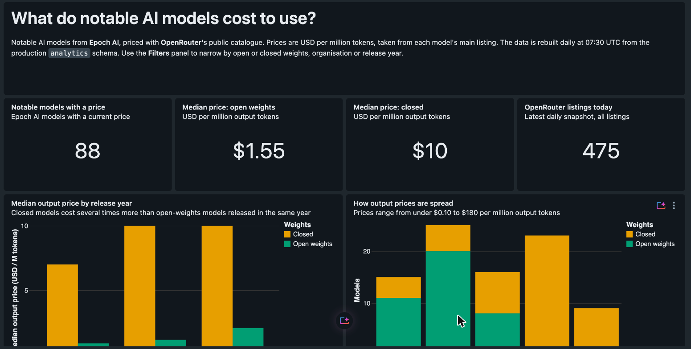

# Dashboards

## `ai_model_prices.lvdash.json`: AI Model Prices

A Databricks AI/BI dashboard on the production marts (`workspace.analytics`), refreshed by the daily production build.



| Widget | Dataset | Answers |
|---|---|---|
| 4 KPI counters | `ds_models`, `ds_latest` | How many notable models have a price; median output price for open vs closed models; how many OpenRouter listings exist today |
| Median output price by release year | `ds_models` | Is the open/closed price gap consistent across years? |
| How output prices are spread | `ds_models` | How many models sit in each price band |
| OpenRouter catalogue, day by day | `ds_daily` | Is the catalogue growing? (gaps in the snapshots are shown, not filled) |
| Who makes the priced models | `ds_org` | Which organisations account for the priced models, top 10 + Other |
| Prices that changed since tracking began | `ds_changes` | Which notable-model listings got cheaper or more expensive |
| Latest price per notable model | `ds_models` | The full price list, cheapest first |

**Filters** (global panel): weights (open/closed), organisation, release year.

### How it's built

- Every dataset query uses **bare table names** (`FROM rpt_models_latest_price`). The catalog and schema (`workspace.analytics`) are set at deploy time, so the same file can point at another schema without edits.
- All business logic stays in dbt. The dataset SQL only shapes data for display: open/closed labels, price bands, top-10 grouping, first-vs-latest comparison.
- Prices are cast from `DECIMAL` to `DOUBLE` **in the dashboard queries only**, because the dashboard formats floating-point numbers but not decimals. The tables keep `decimal`, as `CONVENTIONS.md` requires.
- Open weights are always teal and closed always orange (colour-blind-safe Okabe-Ito colours).

### Deploying changes

The file is the source of truth. After editing it, push it to the existing dashboard (same ID, so the link doesn't change) and publish:

```bash
databricks lakeview update <DASHBOARD_ID> --profile ai-model-tracker \
  --dataset-catalog workspace --dataset-schema analytics \
  --serialized-dashboard "$(cat dashboards/ai_model_prices.lvdash.json)"

databricks lakeview publish <DASHBOARD_ID> --profile ai-model-tracker \
  --warehouse-id <WAREHOUSE_ID> --embed-credentials
```

To find the dashboard ID: Databricks → **Dashboards** → *AI Model Prices*. It's the long ID in the address bar after `/dashboardsv3/`. If you edit the dashboard in the Databricks UI instead, export it (⋮ → *Export*) and commit the file here, so the repo stays in sync.

### Known rendering limits

On this workspace the dashboard renderer ignores number formats on table columns and doesn't apply conditional cell colours. To work around that, table prices are shown to the cent and the price change is calculated as a whole-number percentage in SQL. Counters use a `$` format template, which does render.
